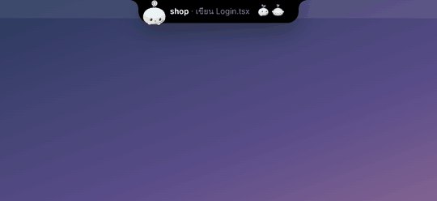
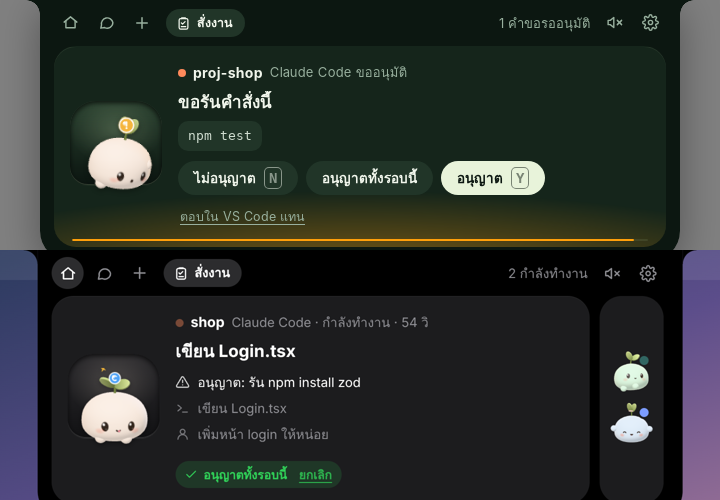

# Marshmori

**Marshmori** (เรียกสั้น ๆ ว่า **Mamori**) — มาร์ชแมลโลว์ตัวน้อยจากผืนป่า (森 *mori*) ที่อาศัยอยู่ขอบบนจอ Windows
คอยดู **Claude Code**, **Codex** และ **Antigravity** ให้ว่ากำลังทำอะไร เกาะขอบแถบด้านบนด้วยมือเล็ก ๆ สองข้าง
**สั่งงานผ่าน Mamori ได้**: พิมพ์งานที่แถบด้านบน เลือก agent กับโฟลเดอร์ แล้ว Mamori ให้ agent ทำเบื้องหลังให้ ส่งงานต่อได้เหมือนคุยใน terminal
เมื่อ agent ขออนุมัติ ทำงานเสร็จ หรือเจอปัญหา Mamori จะเกาะขอบแถบไว้แล้ว **ยืดคอยาว ๆ** หรือ **ยื่นมือยาว ๆ** มาสะกิดบอกถึงข้างเมาส์ (ท่าประจำตัวของน้อง)
กดอนุมัติได้ทั้งตรงนั้นและที่แถบด้านบน แชทได้ และลากไฟล์มาให้ช่วยดูได้ — **ไม่ต้องใส่ API key** ทุกอย่างผ่าน CLI ที่คุณล็อกอินไว้แล้ว

แอปทำงานบนเครื่อง Windows ของคุณโดยตรง เขียนด้วย Tauri 2 (Rust + TypeScript) ตัว Mamori เป็น 3D (three.js)

### มีอะไรใหม่ใน 0.7.1

- **ติดตั้งด้วยปุ่มเดียว**: ดับเบิลคลิกตัวติดตั้ง กด **ติดตั้ง** แล้วรอสักครู่ Marshmori เปิดขึ้นมาเอง ไม่ต้องกดถัดไปหลายหน้า ไม่ต้องเลือกโฟลเดอร์หรือติ๊กอะไร ไอคอนบนเดสก์ท็อปและ Start Menu มาให้เลย อัปเดตทับเวอร์ชันเก่าก็ปุ่มเดียว การตั้งค่าและการเชื่อมต่อ agent อยู่ครบ
- **งาน Antigravity ที่สั่งผ่าน Mamori ทำงานได้จริง**: กดอนุญาตที่การ์ดแล้วคำสั่งรันต่อได้ (เดิม Antigravity ปฏิเสธทุกคำสั่งเองในงานเบื้องหลัง และบางครั้งอ่านไฟล์ไม่ได้เลย) ต้องเชื่อม hooks ของ Antigravity ไว้ ที่ ตั้งค่า › เชื่อมต่อ agent แล้วการ์ดที่ Mamori จะเป็นตัวกั้นตามโหมด "ทำเองได้แค่ไหน" ของงานนั้น

### มีอะไรใหม่ใน 0.7

- **ตอบคำถามของ Claude Code ได้ที่ Mamori**: เวลา Claude Code ถามให้เลือก (AskUserQuestion) การ์ดคำถามขึ้นที่แถบหน้าตาแบบเดียวกับที่ Claude Code ถามเอง ตัวเลือกมีเลข 1, 2, 3 พร้อมคำอธิบาย กดแล้ว Claude Code ทำงานต่อทันที มี **อื่น ๆ** ให้พิมพ์เอง เลือกได้หลายข้อ/หลายคำถาม หรือ **ข้ามคำถามนี้** ให้ Claude ตัดสินใจเอง ใช้ได้ทั้ง terminal, แผง VS Code และงานที่ Mamori สั่ง ถ้า Mamori มาสะกิดถึงเมาส์ กดตอบในฟองข้อความได้เลย
- **ป็อบอัพลื่นขึ้น**: ฟองข้อความเด้งออกมาจากหัว Mamori หลังลงจอดสักครู่ แล้วตามหัวไปแบบนุ่ม ๆ ไม่สั่นตามจังหวะสะกิด การ์ดใบถัดไปค่อย ๆ จางเข้าแทนการสลับทันที
- **การเคลื่อนไหว**: ตั้งค่า › ทั่วไป › **การเคลื่อนไหว** เลือก **ตามระบบ Windows** (ถ้าปิด Animation effects ไว้ แถบจะค่อย ๆ ขยายนุ่ม ๆ ไม่กระโดด และ Mamori ไม่ออกมาสะกิด) หรือ **เต็มที่เสมอ** (เด้งดึ๋งและมาสะกิดได้ตลอด ไม่ว่า Windows ตั้งไว้แบบไหน)
- **ขออนุมัติแผนอ่านง่าย**: ตอนจบ plan mode การ์ดแสดงแผนให้อ่าน แล้วกด **เริ่มตามแผน** หรือ **ยังไม่เริ่ม**

### มีอะไรใหม่ใน 0.6

- **ติดตั้งแบบโปรแกรมปกติ**: ดาวน์โหลดตัวติดตั้งจากหน้า [Releases](https://github.com/Taksin014/marshmori/releases/latest) ดับเบิลคลิก แล้วกดถัดไปตามหน้าจอ ไม่มีหน้าต่างดำ ไม่ต้องลงโปรแกรมอื่นก่อน
- **เห็นงานจาก IDE และ terminal เอง**: เปิดแอปแล้วจะเชื่อมต่อ Claude Code, Codex และ Antigravity ที่เจอในเครื่องให้อัตโนมัติ และถึงตัวไหนยังไม่ได้เชื่อม (หรือ Antigravity IDE ที่ยังไม่รัน hooks) Mamori ก็อ่านบันทึกที่ agent เขียนระหว่างทำงาน แล้วขึ้นที่แถบว่ากำลังคิด ทำอะไรอยู่ หรือเสร็จแล้ว — ไม่ต้องสั่งผ่านหน้าต่าง Mamori (ตัวที่คุณถอดการเชื่อมต่อเองจะไม่ถูกเชื่อมกลับ)
- **สีตามอารมณ์**: สีไล่จากหัวลงมาผสมกับสีของน้อง โกรธแดง เศร้าฟ้า หลงรักชมพู เสร็จแล้วเขียว มีปัญหาม่วง กำลังคิดลาเวนเดอร์ ฯลฯ ค่อย ๆ ไหลลงมาตอนอารมณ์มา และจางขึ้นไปตอนหาย
- **ตัวเนียนขึ้น**: คอที่ยืดออกมาจากไหล่อย่างลื่น ๆ ไม่มีรอยต่อทั้งตรงตัวและตรงหัว แขนสั้นป้อมเหมือนตุ๊กตาในท่าปกติ (ยืดยาวเฉพาะตอนโบกมือหรือเอื้อม) และแขนขาไม่กระตุกสั่นตอนหายใจหรือหยุดขยับ
- **ไอคอนใหม่**: ไม่มีพื้นหลัง หน้า Mamori ใหญ่เต็มไอคอน
- **ขยายแบบดึ๋ง ๆ**: ชี้เมาส์ค้างไว้ แถบจะค่อย ๆ พองออกระหว่างรอ แล้วค่อย ๆ ขยาย ยืดออกด้านข้างก่อน ตามด้วยห้อยลงมา เด้งเลยไปนิดแล้วกระเพื่อมกลับเหมือนเยลลี่ ของข้างในโยกตามไปด้วย และ Mamori ไถลไปนั่งในการ์ดแล้วเด้งดึ๋งตอนถึง เลือกความเด้งได้ที่ ตั้งค่า › ทั่วไป › **การขยาย** (นุ่ม ๆ / ดึ๋ง / ดึ๋งมาก)
<p>
  
  
</p>

### มีอะไรใหม่ใน 0.5

- **ติดตั้งง่าย ดูเป็นโปรแกรม**: ตัวติดตั้งภาษาไทยพร้อมไอคอนบนเดสก์ท็อปและ Start Menu ติดตั้งเสร็จเปิดให้เลย เปิดครั้งแรกมีหน้า **เริ่มต้นใช้งาน** กด **เชื่อมต่อทั้งหมด** ทีเดียวก็ใช้ได้ ถอนการติดตั้งแล้วเก็บกวาด hooks ให้เอง (ดู [ติดตั้ง](#ติดตั้ง))
- **กดอนุญาตได้จริงทุกที่**: ใช้ได้ทั้ง Claude Code ใน terminal และใน **แผงของ VS Code / Cursor** (เดิมแผงนี้ไม่ส่งคำขออนุมัติมาให้เลย) รวมถึงงานที่ Mamori สั่งเอง (ดู [กดอนุญาตจาก Mamori](#กดอนุญาตจาก-mamori))
- **อนุญาตทั้งรอบนี้** (แทน "อนุญาตเสมอ"): กดครั้งเดียว agent ตัวนั้นทำต่อได้ทุกอย่างจนจบงานรอบนี้ สั่งงานครั้งถัดไปจะกลับมาถามใหม่ ยกเลิกก่อนจบรอบได้ที่การ์ดของ session
- **ลากไฟล์และโฟลเดอร์ใส่งานได้แบบ IDE**: วางไฟล์ตอนหน้าสั่งงานเปิดอยู่ = แนบไปกับงาน, วางโฟลเดอร์ = ทำงานในโฟลเดอร์นั้น, คลิกขวาที่โฟลเดอร์ใน Explorer → **สั่งงาน Mamori ที่นี่** และ **ต่อจากงานล่าสุดในโฟลเดอร์นี้** หยิบบทสนทนาที่ค้างไว้ใน terminal หรือ VS Code มาทำต่อ
- **ดอกตูมบอกสถานะ**: ดอกตูมสีเล็ก ๆ บนยอดต้นกล้าของ Mamori บอกว่าตอนนี้กำลังคิด ทำงาน รอคุณอนุมัติ รอคำสั่ง เสร็จแล้ว หรือมีปัญหา ขอบตัวเรืองเป็นสีเดียวกัน และมีหน้า **หลงรัก** (ตาหัวใจ หัวใจลอย ดาววิบวับ) ตอนกดอนุญาตทั้งรอบ — วาดด้วยโค้ดล้วนทั้งหมด ลองดูได้ที่ ตั้งค่า › Mamori › อารมณ์และป้ายสถานะ
<p>
  
  
</p>

- **สั่งงานผ่าน Mamori**: ปุ่ม **สั่งงาน** ที่แถบด้านบน เลือก agent (Claude Code / Codex / Antigravity / Gemini CLI), โฟลเดอร์ และให้ทำเองได้แค่ไหน แล้วพิมพ์งาน Mamori จะรัน agent ตัวนั้นเบื้องหลัง (ไม่มีหน้าต่าง terminal) ดูความคืบหน้า กดอนุมัติ อ่านผลลัพธ์ และสั่งต่อในงานเดิมได้ที่แถบเลย (ดู [สั่งงานให้ Mamori](#สั่งงานให้-mamori))
- **มาสะกิดบอก**: ยืดคอมาเอาหัวดุนเมาส์เบา ๆ เมื่อต้องตัดสินใจหรือมีปัญหา และ **ยื่นมือยาว ๆ มาแตะเมาส์สองที** เมื่องานเสร็จ (หัวยังอยู่ที่แถบ) เลือกได้ที่ ตั้งค่า › Mamori › **สะกิดด้วย**
- **ขยับนุ่ม ๆ ทุกขั้น**: แถบโผล่ ขยาย และหุบด้วยสปริงที่เด้งเบา ๆ แล้วค่อยนิ่ง ระหว่างรอเวลาหน่วง แถบจะขยับเตรียมตัวนิดหนึ่งให้รู้ว่ากำลังจะเปิด ของในแถบค่อย ๆ ลอยขึ้นมาทีละชิ้น
- เรื่องใหม่ที่มาตอนน้องยังยืดคอถามเรื่องอื่นอยู่ จะรอให้น้องกลับมาก่อนแล้วค่อยมาบอก ไม่ตกหล่น

### มีอะไรใหม่ใน 0.4

- **ยืดคอแทนวิ่ง**: ตัวกับมือเกาะขอบแถบไว้ มีแค่หัวที่ยืดคอออกมาหาเมาส์ แล้วม้วนคอกลับเหมือนตลับเมตร
- **หน่วงก่อนแสดง**: ต้องวางเมาส์ค้างไว้ครู่หนึ่ง Mamori ถึงจะโผล่หรือแถบถึงจะขยาย เลื่อนเมาส์ผ่านเร็ว ๆ จะได้กดของที่อยู่ใต้แถบได้ (ปรับได้ 0–3 วินาที)
- **ลื่นขึ้น**: ลดงานที่ทำให้กระตุก (วาดเฉพาะเมื่อจำเป็น, ไม่สร้างหน้าใหม่ทั้งแถบทุก event, ไม่ใช้ blur ตอนเคลื่อนไหว, เปิดใช้เต็มที่แม้หน้าต่างไม่ได้โฟกัส)
- **อยู่บนสุดเสมอ**: กลับขึ้นมาอยู่เหนือโปรแกรมอื่นทุกครั้งที่สลับแอป และไม่หลบหน้าต่างที่แค่ขยายเต็มจอ (Maximize) อีกแล้ว
- **แก้โมเดลขาด**: แขนขาและคอต่อกับตัวสนิท ปลายท่อมีฝาโค้งปิด

---

## ติดตั้ง

ดาวน์โหลด **`Marshmori_<เวอร์ชัน>_x64-setup.exe`** จากหน้า [Releases](https://github.com/Taksin014/marshmori/releases/latest) (เวอร์ชันล่าสุดอยู่บนสุด) ดับเบิลคลิก แล้วกดปุ่ม **ติดตั้ง** ปุ่มเดียว รอสักครู่ Marshmori จะเปิดขึ้นมาเอง — ไม่มีหน้าต่างดำ ไม่ต้องลง Node.js หรือ Rust
ตัวติดตั้งยังไม่ได้เซ็นโค้ด Windows SmartScreen อาจเตือนตอนเปิดครั้งแรก ให้กด **ข้อมูลเพิ่มเติม** (More info) แล้วกด **เรียกใช้ต่อไป** (Run anyway)

ตัวติดตั้งเป็นภาษาไทย ติดตั้งให้ผู้ใช้คนนี้ (ไม่ต้อง admin) สร้างไอคอนบนเดสก์ท็อปและใน Start Menu ให้เอง และเปิด Marshmori ให้เมื่อเสร็จ
จะอัปเดตเวอร์ชันใหม่ก็ดับเบิลคลิกไฟล์ใหม่แล้วกด **ติดตั้ง** เหมือนเดิม Marshmori ที่เปิดอยู่จะปิดให้แล้วเปิดใหม่เอง การตั้งค่าและการเชื่อมต่อ agent อยู่ครบ (ไม่ต้องกด Trust ใน Codex ใหม่)
ถอนการติดตั้งได้ที่ Settings › Apps › Marshmori — Marshmori จะเอา hooks ของตัวเองออกจาก Claude Code / Codex / Antigravity, เอาเมนู "สั่งงาน Mamori ที่นี่" ออกจาก Explorer และเอาออกจากรายการเปิดพร้อม Windows ให้เอง (ติ๊ก "ลบข้อมูลและการตั้งค่าของแอปด้วย" ถ้าอยากลบการตั้งค่าและงานที่เก็บไว้ด้วย)

สำหรับนักพัฒนา: `scripts\build-from-source.cmd` สร้างแอปกับตัวติดตั้งจากซอร์สในโฟลเดอร์นี้แล้วติดตั้งให้ในขั้นเดียว (ต้องมีของตามหัวข้อถัดไป)

### สิ่งที่ต้องมีถ้าสร้างจากซอร์ส (ครั้งเดียว)

1. **Node.js LTS** (เวอร์ชัน 20 ขึ้นไป): https://nodejs.org
2. **Rust**: ติดตั้งผ่าน https://rustup.rs แล้วเลือกค่าเริ่มต้น (`stable-x86_64-pc-windows-msvc`)
3. **Visual Studio Build Tools 2022**: https://visualstudio.microsoft.com/visual-cpp-build-tools/
   ตอนติดตั้งให้ติ๊ก **"Desktop development with C++"**
4. **WebView2**: มีใน Windows 10/11 อยู่แล้ว ไม่ต้องลงเพิ่ม

เช็คว่าพร้อมแล้ว ให้เปิด PowerShell ใหม่แล้วพิมพ์:

```powershell
node -v
cargo -V
```

## รันแบบนักพัฒนา

```powershell
git clone https://github.com/Taksin014/marshmori.git
cd marshmori
npm install
npm run tauri dev
```

- ครั้งแรกจะคอมไพล์ Rust นานราว 3–8 นาที ครั้งต่อไปจะเร็วขึ้นมาก
- `npm run tauri dev` สร้างตัวส่งต่อ `marshmori-hook.exe` ให้อัตโนมัติก่อนเปิดแอป
- ตั้งชื่อโฟลเดอร์อะไรก็ได้ ไม่มีอะไรผูกกับชื่อโฟลเดอร์
- ถ้าเจอปัญหาเรื่อง path ภาษาไทย ให้ย้ายโฟลเดอร์ไปไว้ที่ path ภาษาอังกฤษ เช่น `C:\dev\marshmori`

## สร้างตัวติดตั้ง (.exe) เอง

```powershell
npm run tauri build
```

จะได้ไฟล์ `target\release\bundle\nsis\Marshmori_0.7.1_x64-setup.exe` (`scripts\build-from-source.cmd` ทำขั้นนี้ให้แล้วติดตั้งต่อเลย)

---

## ใช้งานครั้งแรก

1. เปิดแอปครั้งแรกจะมีหน้า **เริ่มต้นใช้งาน** ขึ้นมา (เปิดดูอีกได้ที่แท็บแรกของหน้าตั้งค่า)
2. Marshmori เชื่อมต่อทุก agent ที่พบในเครื่องให้เองตอนเปิด (ดู/ถอด/เชื่อมใหม่ทีละตัวได้ที่แท็บ **เชื่อมต่อ agent**)
   - **Claude Code**: เปิด session ใหม่หลังเชื่อม (ทั้งใน terminal และใน VS Code)
   - **Codex**: เปิด Codex แล้วพิมพ์ `/hooks` เพื่อกด **Trust** ครั้งแรก (Codex บังคับให้ยืนยัน hook ใหม่ทุกครั้ง)
   - **Antigravity**: รีสตาร์ทหนึ่งครั้ง ถ้าอยากกดอนุญาตคำสั่งจาก Mamori ให้เปิด ตั้งค่า › การอนุมัติ › **ถามก่อน Antigravity รันคำสั่ง**
3. เลือกว่าจะให้เปิดพร้อม Windows และมีเมนู **สั่งงาน Mamori ที่นี่** ในโฟลเดอร์ไหม (เปิดไว้เป็นค่าเริ่มต้น) แล้วกด **เริ่มใช้งาน**
4. ไม่อยากรอ agent จริงก็กด **ดูตัวอย่าง** ได้ จะเห็นทั้งสามตัวทำงานพร้อมการ์ดขออนุมัติหนึ่งใบ
4. แชท: ไม่ต้องตั้งอะไร ถ้าเคยล็อกอิน `claude`, `codex`, `agy` หรือ `gemini` ใน terminal ไว้แล้วก็ใช้ได้เลย
   (แท็บ **แชท** บอกว่าตัวไหนพร้อม และเตือนถ้าตัวไหนล็อกอินด้วย API key ซึ่งจะถูกคิดเงินตามการใช้งาน)

### หน้าตาแถบด้านบน

ตั้งค่า › ทั่วไป › **หน้าตาแถบด้านบน** เลือกได้ 5 แบบ:

| แบบ | เป็นยังไง |
|---|---|
| **ตามระบบ** (ค่าเริ่มต้น) | สว่างหรือมืดตามโหมดของ Windows เปลี่ยนตามทันทีเมื่อสลับโหมด |
| **เข้ม** | ดำแบบ notch ของ Mac — Mamori เด่นที่สุด |
| **สว่าง** | ขาวสะอาด Mamori ยังยืนเด่นในช่องสีโกโก้ |
| **ป่า** | กระจกสีเขียวเข้ม บ้านของ Marshmori |
| **มิดไนท์** | น้ำเงินเข้มยามค่ำ |

ฟองข้อความตอน Mamori ยืดคอมาหาเมาส์ก็ใช้หน้าตาเดียวกัน

### ใช้ Mamori ยังไง

| ทำอะไร | ผลที่ได้ |
|---|---|
| เลื่อนเมาส์ขึ้นไปขอบบนกลางจอแล้ววางค้างไว้ | Mamori โผล่จาก notch เกาะขอบทักทาย |
| วางเมาส์ค้างที่แถบด้านบน | ขยายดูทุก session |
| เลื่อนเมาส์ผ่านเร็ว ๆ | ไม่มีอะไรเด้งขึ้นมาบัง กดของที่อยู่ใต้แถบได้ตามปกติ |
| คลิกที่ Mamori | ปักหมุดให้แถบเปิดค้าง (จิ้มรัว ๆ จะงง) |
| มีการ์ดขออนุมัติ | กด อนุญาต / **อนุญาตทั้งรอบนี้** / ไม่อนุญาต หรือ **Ctrl+Alt+Y** / **Ctrl+Alt+N** จากที่ไหนก็ได้ |
| Claude Code ถามคำถาม (ให้เลือกคำตอบ) | การ์ดคำถามขึ้นที่แถบ เหมือนที่ Claude Code ถามเอง: ตัวเลือกมีเลข 1, 2, 3 พร้อมคำอธิบาย กดเลือกแล้ว Claude Code ทำต่อทันที, **อื่น ๆ** พิมพ์คำตอบเอง, เลือกได้หลายข้อ/หลายคำถามก็กด **ส่งคำตอบ** หรือ **ข้ามคำถามนี้** ให้ Claude ตัดสินใจเอง ถ้า Mamori มาสะกิดถึงเมาส์ กดตัวเลือกในฟองข้อความได้เลย |
| มีเรื่องสำคัญตอนเมาส์อยู่ไกล | Mamori เกาะขอบแถบไว้แล้วมาสะกิดถึงข้างเมาส์พร้อมฟองข้อความ: ยืดคอมาเอาหัวดุนเมาส์เมื่อต้องตัดสินใจหรือมีปัญหา, ยื่นมือมาแตะเมาส์สองทีเมื่องานเสร็จ กดตอบได้ตรงนั้น หรือคลิกน้องเพื่อเปิดแถบด้านบน เสร็จแล้วคอ/แขนจะม้วนกลับเอง |
| ไม่อยากให้มาสะกิด | ตั้งค่า › Mamori › **มาสะกิดบอก**: ทุกเรื่อง / เฉพาะขออนุมัติ / ปิด และเลือก **สะกิดด้วย**: ตามเรื่อง / ยื่นหัว / ยื่นมือ |
| อยากให้ agent ทำงานให้ | กด **สั่งงาน** ที่แถบด้านบน (ดูด้านล่าง) |
| ไม่ตอบการ์ดภายในเวลาที่ตั้งไว้ (เริ่มต้น 110 วินาที) | agent จะกลับไปถามในหน้าจอของมันเองตามปกติ |
| ลากไฟล์มาที่แถบ | Mamori อ้าปากรอ ปล่อยไฟล์แล้วกด "ถาม …" (รูป, PDF, ไฟล์ข้อความ/โค้ด) หรือ **สั่งงานกับไฟล์นี้** |
| ลากโฟลเดอร์มาที่แถบ | กด **สั่งงานในโฟลเดอร์นี้** แล้วพิมพ์งานได้เลย |
| คลิกขวาที่โฟลเดอร์ใน Explorer | **สั่งงาน Mamori ที่นี่** เปิดหน้าสั่งงานในโฟลเดอร์นั้น (บน Windows 11 อยู่ใน "Show more options") |
| ดูดอกตูมบนยอดต้นกล้า | ม่วง = คิดอยู่, ฟ้า = ทำงาน, เหลือง = รอคุณอนุมัติ, ส้ม = รอคำสั่ง, เขียว ✓ = เสร็จ, แดง = มีปัญหา, จุดเขียวเล็ก = agent อยู่ ไม่มีอะไรค้าง |
| คลิกไอคอนที่ถาดระบบ | ซ่อนหรือเรียก Mamori กลับ |

ปรับเวลาที่ต้องวางเมาส์ค้างได้ที่ ตั้งค่า › ทั่วไป › **หน่วงก่อนแสดง** (0–3 วินาที ค่าเริ่มต้น 0.6 วินาที ถ้าแถบโผล่มาบังแท็บหรือแถบชื่อหน้าต่างบ่อย ให้เพิ่มเวลา)

ท่าทางของ Mamori: มือสองข้างเกาะขอบแถบและขยับตามอารมณ์ (พิมพ์งานตอนทำงาน, โบกมือตอนขออนุมัติ, ชูมือตอนเสร็จ, จับแก้มตอนเขิน)
คอยืดได้ (Long Neck) แขนยืดยาวเป็นเส้นนุ่ม ๆ ได้ไกล (Long Arms) — ลองกดดูได้ที่ตั้งค่า › Mamori

ถ้าปิด **Animation effects** ของ Windows ไว้ (Settings › Accessibility › Visual effects) แถบจะไม่เด้งดึ๋ง แต่ค่อย ๆ ขยาย/หุบอย่างนุ่มนวลแทนการกระโดด และ Mamori จะไม่ยืดคอออกมาสะกิด อยากได้ท่าเต็ม ๆ ให้เปิดตัวเลือกนั้น หรือถ้าอยากปิดไว้ทั้งเครื่อง แต่ให้ Mamori ขยับเต็มที่ ให้เลือก ตั้งค่า › ทั่วไป › **การเคลื่อนไหว** › **เต็มที่เสมอ** (ค่าเริ่มต้นคือ **ตามระบบ Windows**)

Mamori จะไม่ออกมาสะกิดเมื่อ: เมาส์อยู่ใกล้แถบด้านบนอยู่แล้ว, คุณกำลังใช้แถบ (แชท/สั่งงาน/ปักหมุด/ลากไฟล์), เปิดแอปเต็มจอ, เมาส์อยู่คนละจอ, Windows ตั้งให้ลดภาพเคลื่อนไหว (และ **การเคลื่อนไหว** เป็น **ตามระบบ Windows**) หรือ (สำหรับงานเสร็จ/มีปัญหา) เพิ่งออกมาบอกเรื่องอื่นไปไม่ถึง 25 วินาที

### สั่งงานให้ Mamori

1. ชี้เมาส์ที่แถบด้านบนให้แถบเปิด แล้วกด **สั่งงาน** (หรือลากโฟลเดอร์มาวาง หรือคลิกขวาที่โฟลเดอร์ › **สั่งงาน Mamori ที่นี่**)
2. เลือก **ให้ใครทำ** (เฉพาะ agent ที่มีในเครื่อง), **ที่โฟลเดอร์** (โฟลเดอร์ที่เคยใช้ กด **เลือก…** หรือลากโฟลเดอร์มาวาง) และ **ทำเองได้แค่ไหน**
3. พิมพ์งานแล้วกด Enter (Shift+Enter ขึ้นบรรทัดใหม่)

**แนบไฟล์แบบ IDE**: ลากไฟล์มาวางที่แถบตอนหน้าสั่งงานเปิดอยู่ (หรือกดรูปคลิปหนีบ) ไฟล์จะขึ้นเป็นชิปเหนือช่องพิมพ์ แล้วส่งไปกับงานเป็น path ให้ agent เปิดอ่านเอง ได้ครั้งละ 10 ไฟล์ ไฟล์ที่อยู่นอกโฟลเดอร์งาน Mamori บอก agent ให้อ่านโฟลเดอร์นั้นได้ด้วย (Claude Code `--add-dir`, Gemini `--include-directories`) ตอนสั่งต่อก็แนบได้เหมือนกัน

**ต่อจากงานล่าสุดในโฟลเดอร์นี้**: เปิดสวิตช์ใต้ช่องพิมพ์ แล้ว agent จะหยิบบทสนทนาล่าสุดของมันในโฟลเดอร์นั้นมาทำต่อ เช่นที่คุยค้างไว้ใน terminal หรือ VS Code (Claude Code `--continue`, Codex `resume --last`, Gemini `--resume latest` · Antigravity ยังทำไม่ได้)

Mamori รัน CLI ของ agent ตัวนั้นเบื้องหลังในโฟลเดอร์ที่เลือก ด้วยบัญชีที่ล็อกอินไว้แล้ว (ไม่มี API key ในแอป) งานส่งไปทาง stdin ไม่ผ่าน command line
ระหว่างทำจะเห็นว่ากำลังทำอะไร ถ้า agent ขออนุมัติ การ์ดจะขึ้นที่แถบ (หรือ Mamori มาสะกิดถ้าเมาส์อยู่ไกล) เพราะงานเบื้องหลังไม่มี terminal ให้ตอบ
เสร็จแล้วผลลัพธ์อยู่ในหน้าของงานนั้น พิมพ์สั่งต่อได้เลย (ต่อจากบทสนทนาเดิมของ agent) กด **หยุดงาน** เมื่อไหร่ก็ได้

| ทำเองได้แค่ไหน | Claude Code | Codex | Antigravity | Gemini CLI |
|---|---|---|---|---|
| **ถามก่อน** | อ่านเองได้ แก้ไฟล์/รันคำสั่งต้องขออนุมัติ | แก้ไฟล์ได้เฉพาะในโฟลเดอร์ ไม่ออกเน็ต (sandbox ของ Codex ไม่ถามระหว่างทาง) | อ่านเองได้ แก้ไฟล์ รันคำสั่ง ใช้ MCP เปิดเว็บ และควบคุมเบราว์เซอร์ต้องขออนุมัติ | อ่านอย่างเดียว |
| **แก้ไฟล์ได้** | แก้ไฟล์เองได้ รันคำสั่งต้องขออนุมัติ | เหมือนข้างบน | แก้ไฟล์ในโฟลเดอร์งานและเปิดเว็บเองได้ รันคำสั่ง ใช้ MCP ควบคุมเบราว์เซอร์ และแก้ไฟล์นอกโฟลเดอร์ต้องขออนุมัติ | แก้ไฟล์ได้ ไม่รันคำสั่ง |
| **อัตโนมัติ** | auto mode ของ Claude (มีตัวตรวจความปลอดภัยคอยดู) | เหมือนข้างบน | เหมือนข้างบน และรันคำสั่งที่แค่ดูข้อมูลได้เอง (เช่น `ls`, `git status`) คำสั่งอื่นยังขออนุมัติ | แก้ไฟล์ได้ ไม่รันคำสั่ง |
| **วางแผน** | plan mode: ดูโค้ดแล้วเขียนแผน ไม่แก้อะไร | อ่านอย่างเดียว | อ่านอย่างเดียว: Mamori ปฏิเสธการแก้ไฟล์และคำสั่งทุกอย่างเอง ไม่ขึ้นการ์ด | สั่งให้แค่วางแผน |

- งานที่สั่งล่าสุด 30 งาน (คำสั่งกับผลลัพธ์ ไม่รวมไฟล์) เก็บไว้ใน `%APPDATA%\Marshmori\tasks.json` ปิดแอประหว่างงานยังทำอยู่ = งานนั้นหยุด
- ทำพร้อมกันได้สูงสุด 4 งาน ถ้า agent เงียบนานเกิน 45 นาที หรือทำนานเกิน 4 ชั่วโมง Mamori จะหยุดให้
- ถ้า hooks ของ agent ตัวนั้นเชื่อมไว้ (แท็บ **เชื่อมต่อ agent**) งานจะขึ้นเป็น session ในแถบพร้อมรายละเอียดทีละขั้น ถ้าไม่ได้เชื่อม Mamori ยังบอกสถานะคร่าว ๆ จากผลลัพธ์ของ CLI ได้

### กดอนุญาตจาก Mamori

| ที่ไหน | เป็นยังไง |
|---|---|
| Claude Code ใน terminal (รวม terminal ใน VS Code / JetBrains) | การ์ดขึ้นตอน Claude Code จะถาม (PermissionRequest) กดที่ Mamori แล้ว terminal ไม่ต้องตอบซ้ำ |
| **Claude Code ในแผงของ VS Code / Cursor / แอป Claude** | แผงนี้ไม่ส่งคำขออนุมัติออกมาเลย Mamori จึงถามก่อนหนึ่งจังหวะ (PreToolUse) — เฉพาะสิ่งที่ Claude Code จะถามเองจริง ๆ ตามโหมดและกฎ allow/deny ใน `settings.json` ของคุณ คำสั่งที่อ่านอย่างเดียวอย่าง `ls`, `git status` ไม่ถาม กด **ตอบใน VS Code แทน** หรือปล่อยให้หมดเวลา แล้ว VS Code จะถามเองตามปกติ |
| Codex (CLI และส่วนขยายใน IDE) | การ์ดขึ้นตอน Codex ขอสิทธิ์ (PermissionRequest) |
| Antigravity | เปิด ตั้งค่า › การอนุมัติ › **ถามก่อน Antigravity รันคำสั่ง** แล้วคำสั่งจะมาขออนุมัติที่ Mamori ก่อน |
| งานที่ Mamori สั่ง | ถามที่ Mamori เสมอ (ไม่มี terminal ให้ตอบ) ไม่ตอบ = ไม่อนุญาต · งานของ Antigravity: ถ้าเชื่อม hooks ไว้ Mamori รัน `agy` แบบข้ามการถามของมันเอง (`--dangerously-skip-permissions`) แล้วให้การ์ดที่ Mamori เป็นตัวกั้นแทนตามตาราง "ทำเองได้แค่ไหน" (ไม่อย่างนั้น `agy` เบื้องหลังจะปฏิเสธทุกคำสั่งเอง) เครื่องมือที่ Mamori ไม่รู้จักขออนุมัติเสมอ โหมดวางแผนไม่ข้ามเด็ดขาด และถ้าถอดการเชื่อม hooks ระหว่างที่งานแบบนี้รันอยู่ งานจะหยุดทันที |

**คำถามจาก Claude Code** (AskUserQuestion): ตอบได้ที่ Mamori ทั้งใน terminal, แผงของ VS Code / Cursor และงานที่ Mamori สั่ง คำตอบส่งกลับไปให้ Claude Code ทำงานต่อทันทีโดยไม่ต้องสลับหน้าต่าง ถ้าไม่ตอบภายในเวลาที่ตั้งไว้ หรือกด **ตอบใน terminal แทน** Claude Code จะถามในหน้าจอของมันเองตามปกติ (งานที่ Mamori สั่งไม่มีหน้าจอให้ถาม จึงข้ามคำถามแล้วให้ Claude เลือกเอง) · การ์ดขออนุมัติแผน (ตอนจบ plan mode) แสดงแผนให้อ่านก่อนกด **เริ่มตามแผน**
Codex และ Antigravity ยังไม่มี hook สำหรับตอบคำถามแบบนี้

**อนุญาตทั้งรอบนี้**: อนุญาตอันนี้และทุกอย่างที่ session เดียวกันขอต่อจากนี้ จนจบงานรอบนั้น พอคุณพิมพ์สั่งงานครั้งถัดไป (หรือ agent ทำเสร็จ) ก็กลับมาถามตามปกติ ระหว่างนั้นการ์ดของ session มีป้ายสีเขียว **อนุญาตทั้งรอบนี้ · ยกเลิก**
(กฎ "อนุญาตเสมอ" แบบถาวรของ 0.4 ถูกล้างออกตอนอัปเดต เพราะความหมายเปลี่ยนเป็นทั้งรอบแล้ว)

ตอนอัปเดตจาก 0.4 Marshmori ปรับ hooks ที่เชื่อมไว้ให้เอง (Claude Code ต้องรอ PreToolUse ได้นานขึ้น) แล้วแจ้งเตือนให้เปิด session ใหม่

### อยู่บนสุดเสมอ

แถบด้านบนอยู่เหนือโปรแกรมอื่นตลอด ทุกครั้งที่สลับไปใช้แอปอื่น Mamori จะดันตัวเองกลับขึ้นมาบนสุด
หน้าต่างที่ขยายเต็มจอ (Maximize) ไม่ทำให้แถบหลบแล้ว จะหลบเฉพาะแอปที่เต็มจอจริง ๆ อย่างเกม วิดีโอ หรือสไลด์
ถ้าอยากให้อยู่แม้ตอนนั้น ปิด ตั้งค่า › ทั่วไป › **หลบตอนเปิดแอปเต็มจอ**

---

## ทำงานยังไง

```
Claude Code ─┐
Codex ───────┼─► marshmori-hook.exe ──HTTP 127.0.0.1──► Marshmori ──► แถบด้านบนจอ (Mamori เกาะขอบ)
Antigravity ─┘   (ตัวส่งต่อเล็ก ๆ)      (พอร์ต + token สุ่มใหม่       └─► หน้าต่างใสชั่วคราว (ตอนยืดคอไปหาเมาส์)
                                         ทุกครั้งที่เปิดแอป)

แชท: Marshmori ──stdin──► claude / codex / agy / gemini (CLI ที่ล็อกอินไว้) ──► คำตอบแบบ streaming
```

- agent แต่ละตัวเรียก `marshmori-hook.exe` ทุกครั้งที่มี event (เริ่มคิด, ใช้เครื่องมือ, ขออนุญาต, เสร็จงาน)
- ถ้า Marshmori ไม่ได้เปิดอยู่ ตัวส่งต่อจะจบทันทีโดยไม่ส่งอะไรออกมา agent ก็ทำงานต่อตามปกติ
- การ์ดขออนุมัติตอบกลับในรูปแบบที่แต่ละ agent ระบุไว้ในเอกสาร hooks ของตัวเอง
- แชทส่งข้อความทาง stdin ของ CLI (ไม่ผ่าน command line) และปิด hooks ของ CLI ตัวนั้นระหว่างแชท ไม่มี API key ในแอปเลย
- ตอนมาสะกิด: หน้าต่างใสคลุมจอที่แถบอยู่ คลิกทะลุได้ทุกที่ยกเว้นหัว (หรือมือ) ของ Mamori กับฟองข้อความ และปิดตัวเองเมื่อไม่ได้ใช้
- งานที่สั่งผ่าน Mamori: รัน `claude -p` / `codex exec` / `agy` / `gemini -p` เบื้องหลัง hooks ของงานนั้นติดป้ายว่าเป็นงานของ Mamori (`MARSHMORI_TASK`) การ์ดขออนุมัติของงานนั้นจึงขึ้นที่แถบเสมอ

| | ไฟล์ที่ Marshmori แก้ | หมายเหตุ |
|---|---|---|
| Claude Code | `%USERPROFILE%\.claude\settings.json` | เขียนแบบ exec form (`command` + `args`) ไม่ผ่าน shell |
| Codex | `%USERPROFILE%\.codex\hooks.json` | ต้องกด Trust ใน `/hooks` |
| Antigravity | `%USERPROFILE%\.gemini\config\hooks.json` | อยู่ในกลุ่ม `"marshmori"` แยกจาก hooks อื่น |

ก่อนแก้ไฟล์ทุกครั้ง Marshmori จะสำรองไฟล์เดิมไว้ข้างกัน (`*.marshmori-backup-วันที่`)
ถ้าไฟล์เดิมอ่านไม่ได้ (JSON เสีย) จะไม่เขียนทับ
ถอนแอปด้วยตัวถอนการติดตั้ง Marshmori จะเอา hooks ของตัวเองออกให้ (อัปเดตเวอร์ชันไม่แตะ hooks)

เมนู **สั่งงาน Mamori ที่นี่** อยู่ใน registry ของผู้ใช้ (`HKCU\Software\Classes\Directory\shell\Marshmori` และ `...\Directory\Background\shell\Marshmori`) ปิดได้ที่ ตั้งค่า › ทั่วไป

### ไฟล์ของแอป

- `%APPDATA%\Marshmori\settings.json`: การตั้งค่า (ไม่มีความลับใด ๆ)
- `%APPDATA%\Marshmori\endpoint.json`: พอร์ตและ token ที่ตัวส่งต่อใช้
- `%LOCALAPPDATA%\Marshmori\bin\marshmori-hook.exe`: ตัวส่งต่อที่ hooks ชี้มา
- `%LOCALAPPDATA%\Marshmori\marshmori.log`: log ไว้ดูตอน hooks ไม่ทำงาน (ไม่มีเนื้อหาแชทหรือไฟล์)

---

## โครงสร้างโค้ด

```
src-tauri/src/
  lib.rs         เริ่มแอป, คำสั่งที่หน้าเว็บเรียก
  server.rs      รับ event จากตัวส่งต่อ (127.0.0.1 + token)
  agents.rs      แปลง event ของทั้ง 3 agent ให้เป็นแบบเดียวกัน + คำอธิบายภาษาไทย
  sessions.rs    สถานะของแต่ละ session + ประวัติวันนี้
  approvals.rs   การ์ดขออนุมัติ, รูปแบบคำตอบของแต่ละ hook (PermissionRequest / PreToolUse / Antigravity)
  gate.rs        Claude Code จะถามเองไหม (โหมด, กฎ allow/deny/ask, คำสั่งที่อ่านอย่างเดียว) — ใช้กับแผง VS Code และงานเบื้องหลัง
  pipeline.rs    เส้นทางของ event หนึ่งตัวตั้งแต่รับจนตอบ, อนุญาตทั้งรอบ
  installer.rs   ติดตั้ง/ถอน/ย้าย hooks ในไฟล์ตั้งค่าของแต่ละ agent
  island.rs      หน้าต่างด้านบนจอ, คลิกทะลุส่วนที่โปร่งใส, ดันขึ้นบนสุด, ซ่อนตอนเต็มจอ
  roam.rs        หน้าต่างใสที่ Mamori ยืดคอ/ยื่นมือไปสะกิดที่เมาส์ (เปิดเฉพาะตอนใช้)
  chat.rs        แชทผ่าน CLI ที่ล็อกอินไว้ (claude / codex / agy / gemini) แบบ streaming
  tasks.rs       งานที่สั่งผ่าน Mamori: รัน agent เบื้องหลัง, ติดตามผล, สั่งต่อ, หยุด, tasks.json
  files.rs       ไฟล์ที่ลากมาวาง (ตรวจชนิด/ขนาด แล้วส่งให้ CLI อ่าน)
  settings.rs    การตั้งค่า + ย้ายค่าจากเวอร์ชันเก่า
  paths.rs       ที่เก็บไฟล์ของแอป
  platform.rs    Win32 (Alt-Tab, บนสุดเสมอ, ลากไฟล์, ตรวจแอปเต็มจอ, เมนูโฟลเดอร์ใน Explorer)
  watch.rs       อ่านบันทึกการทำงานของ Claude Code / Codex / Antigravity เพื่อเห็น session ที่ไม่มี hook (IDE, terminal)
src-tauri/installer/  ตัวติดตั้ง: ภาษาไทย, ภาพหัว/ข้าง, ขั้นตอนตอนถอนการติดตั้ง (hooks.nsh)
scripts/install.ps1   สร้างจากซอร์สแล้วติดตั้งในขั้นเดียว (scripts\build-from-source.cmd เรียกตัวนี้)
hook/src/main.rs ตัวส่งต่อ marshmori-hook.exe
src/mascot/
  shape.ts       รูปทรงหัว (โดมโมจิ ก้นแบน) และลำตัว
  model.ts       Marshmori 3D: ผิวนุ่ม, ต้นอ่อนสองใบ, แขนขา/คอเป็นท่อนุ่มที่ยืดได้, ท่ายืดคอข้ามจอ
  rig.ts         สปริงทุกส่วน + ท่าทาง (ยืน ชี้ โบกมือ ชูมือ คอยาว แขนยาว เกาะขอบ)
  face.ts        หน้า (ตา ปาก แก้ม) วาดลงบนผิวหัว
  expressions.ts 24 อารมณ์ + มือทำอะไรในแต่ละอารมณ์ + สีของดอกตูมบอกสถานะ
  marsh.ts       ตัว Marshmori (WebGL) + เอฟเฟกต์รอบหัว + ดอกตูมบอกสถานะและแสงขอบตามอารมณ์
src/core/look.ts หน้าตาแถบ (ตามระบบ / เข้ม / สว่าง / ป่า / มิดไนท์)
src/roam/        สมองตอนมาสะกิด (ยืดคอหรือยื่นมือ, เส้นโค้ง Bézier + สปริง, แตะสองที), ฟองข้อความ
src/island/      แถบด้านบนจอ (Dynamic Island + สปริงนุ่ม ๆ, หน่วงก่อนแสดง), tasks.ts = หน้าสั่งงาน
src/settings/    หน้าตั้งค่า (สไตล์ iOS/macOS)
dev/             หน้าทดลอง: dev/marsh.html (ทุกท่า/อารมณ์), dev/roam.html (ลองยืดคอไปหาเมาส์),
                 dev/island-mock.html (ลองแถบ), dev/settings-mock.html (ลองหน้าตั้งค่า)
previews/        ภาพและ GIF ตัวอย่าง
```

ทดสอบ:

```powershell
cargo test --workspace
npm run typecheck
```

ระหว่าง `npm run dev` เปิดในเบราว์เซอร์เพื่อดูหน้าตาได้ทันที:

- http://127.0.0.1:1420/dev/island-mock.html?scenario=approval&look=light
  (scenario: tuck, peek, pill, panel, approval, question, questions, plan, done, error, drop, file, folder, chat, round, task-form, task-files, task-run, task-done · look: auto, dark, light, forest, midnight · `&timers` ให้เฟรมเดินด้วย timer เวลาหน้าต่างไม่ได้วาดอยู่)
- http://127.0.0.1:1420/dev/marsh.html — ทุกท่าและอารมณ์ของ Marshmori
- http://127.0.0.1:1420/dev/roam.html — ขยับเมาส์แล้วกดปุ่ม ดู Mamori มาสะกิด (`?reach=head` หรือ `?reach=hand` บังคับท่า, ปุ่ม **ถามคำถาม** ดูฟองที่กดตอบได้)

---

ไอเดียแถบด้านบนจอได้แรงบันดาลใจจาก [Coucou](https://github.com/Louis-CFM/coucou) (MIT) ดู `THIRD_PARTY_NOTICES.md`
ตัวละคร Marshmori ชื่อ ไอคอน และเสียงของแอปออกแบบใหม่ทั้งหมด

© 2026 Taksin Kaewwongsa — สงวนลิขสิทธิ์ทั้งหมด (All rights reserved) ห้ามคัดลอก ดัดแปลง หรือเผยแพร่โดยไม่ได้รับอนุญาต ดู [`LICENSE`](LICENSE)
